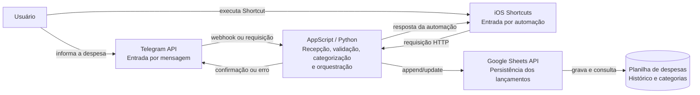
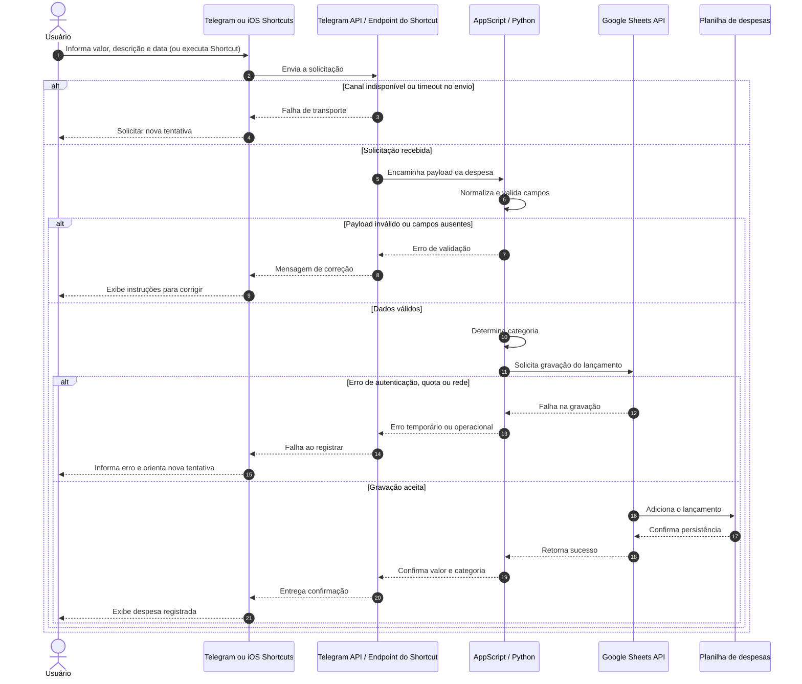

<!-- course-navigation:start -->

  

[← Catálogo de cursos e projetos](https://github.com/MatheusBenvindo/MatheusBenvindo/blob/main/CURSOS.md) · [Perfil](https://github.com/MatheusBenvindo)

<!-- course-navigation:end -->

# Sistema de Rastreamento e Categorização de Despesas

## Escopo e objetivo

Este sistema pessoal recebe despesas informadas pelo usuário, processa e categoriza cada lançamento e registra o resultado em uma base do Google Sheets. O objetivo é reduzir o atrito de registrar gastos no momento em que acontecem, evitando a manutenção de um aplicativo dedicado e centralizando o histórico em uma ferramenta já conhecida e fácil de consultar.

O fluxo suporta duas interfaces de entrada: mensagens enviadas pelo Telegram e automações executadas por iOS Shortcuts. Essas interfaces encaminham os dados para uma camada de backend composta por Google Apps Script e/ou scripts Python. O backend interpreta a entrada, aplica as regras de categorização, valida os campos e grava o lançamento na planilha.

## Nível da visão

Esta documentação combina uma visão de **Containers**, inspirada no C4 Model, com um fluxo de dados operacional. Os containers representam responsabilidades lógicas e pontos de integração; não implicam necessariamente processos ou serviços implantados separadamente.

## Limites e responsabilidades

- **Início do sistema:** o usuário informa uma despesa pelo Telegram ou executa um Shortcut no iPhone.
- **Entrada e transporte:** Telegram API e o mecanismo de automação do iOS entregam a solicitação ao backend.
- **Processamento:** AppScript/Python normaliza a entrada, valida os dados, categoriza a despesa e controla a resposta ao usuário.
- **Persistência:** Google Sheets API grava os campos do lançamento na planilha de despesas.
- **Fim do sistema:** o backend retorna uma confirmação ou um erro ao canal de origem. A planilha é o armazenamento de registro; não há, nesta visão, um banco transacional adicional.

## Integrações

- **Telegram API:** recebe mensagens e permite enviar a confirmação ou o erro de processamento.
- **iOS Shortcuts:** captura e envia uma despesa a partir de uma automação no celular.
- **Google Sheets API:** persiste os lançamentos e disponibiliza o histórico para consulta e análise.

## Diagrama estrutural: containers

O diagrama trata Telegram, Shortcuts, backend e Sheets como containers lógicos. O detalhe de implantação, como um webhook público, autenticação e separação entre AppScript e Python, ainda precisa ser definido pelo sistema real.

## Diagrama comportamental: registro de uma nova despesa

## Restrições e lacunas conhecidas

- O nível de segurança não está definido: ainda faltam autenticação do endpoint, gestão de segredos, autorização da planilha e política para dados sensíveis.
- O comportamento para erros de rede, reprocessamento e duplicidade não está especificado. Uma nova tentativa pode criar um lançamento repetido sem uma chave de idempotência.
- Telegram, Google Sheets e eventuais endpoints possuem quotas, limites de requisição e políticas de timeout que precisam ser confirmados para o volume esperado.
- A separação entre AppScript e Python, bem como o local de execução de cada script, não foi fornecida.
- O formato exato da mensagem, os campos obrigatórios, as regras de categoria e o formato da resposta ainda são hipóteses de documentação, não contratos implementados.

## Decisões Arquiteturais e Ajustes

### Integrações em vez de aplicativo dedicado

A combinação de Telegram e iOS Shortcuts foi escolhida porque permite registrar uma despesa rapidamente, usando interfaces presentes no celular e com baixo custo de desenvolvimento e manutenção. O Google Sheets também oferece consulta e edição imediatas para um sistema pessoal. Um aplicativo dedicado poderia oferecer mais controle de UX e validação, mas aumentaria o esforço de distribuição, autenticação, manutenção e sincronização.

### Inferências usadas nos diagramas

Como não foram fornecidos código, exemplos de payload ou o modelo da planilha, foi necessário inferir que uma despesa possui pelo menos valor, descrição e data, que recebe uma categoria e que o backend responde ao mesmo canal de origem. Também foi inferida uma etapa de validação, uma chamada de gravação na Google Sheets API e retornos de sucesso e falha. Essas inferências descrevem o fluxo provável e devem ser confirmadas antes da implementação.

### O que falta para gerar 100% do código sem inventar regras

Para que um agente autônomo produza o código-fonte completo com fidelidade, ainda são necessários:

- dicionário de dados da planilha, incluindo nomes, tipos, obrigatoriedade e ordem das colunas;
- exemplos reais e contrato exato dos payloads do Telegram e do iOS Shortcuts;
- regras determinísticas de categorização, incluindo categorias permitidas e tratamento de casos ambíguos;
- contratos de autenticação, autorização, URLs, headers e formato de todos os retornos;
- política de idempotência, retries, timeout, quota e tratamento de erros;
- fluxos de fallback quando Telegram, Shortcuts, backend ou Google Sheets estiverem indisponíveis;
- requisitos de observabilidade, retenção de logs, proteção de segredos e ambientes de execução;
- critérios de aceitação e exemplos de testes para registros válidos, inválidos, duplicados e parcialmente processados.

## Navegação dos materiais

| Pasta ou arquivo | Acesso |
|---|---|

